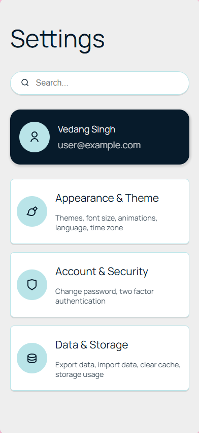
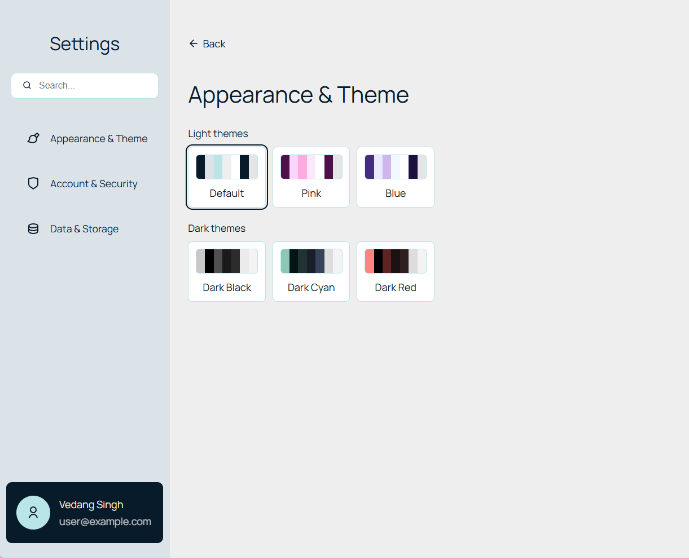

# Settings Page Component

A lightweight, modern, animated & fully responsive Settings page component for React applications with built-it theming support.

<p align="center">

  &nbsp;
  
</p>

---

## Table of Contents

- [Features](#features)
- [Installation](#installation)
- [Quick Start](#quick-start)
- [Component API & Props](#component-api--props)
  - [`<SettingsPage />`](#settingspage-)
  - [`<SettingsThemesPage />`](#settingsthemespage-)
  - [Options & Configurations](#options--configurations)
- [Theming System](#theming-system)
  - [How It Works](#how-it-works)
  - [Adding Custom Themes](#adding-custom-themes)
- [License](#license)

---

## Features

- **📱 Fully Responsive:** For both desktop and mobile devices.
- **🎨 Built-in Theming System:** Ships with 6 light and dark preloaded themes.
- **🚀 Zero Icon Lock-in:** Use Lucide, Remix, Heroicons, FontAwesome, or pure SVGs.
- **🔍 Built-in Search:** Instant filtering across all category titles and descriptions.

---

## Installation

Install directly from GitHub:

```bash
npm install github:Vedang-Singh/settings-page
```

*Peer Dependencies: Ensure your project has `react` and `react-dom`.*

---

## Quick Start

```tsx
import { 
  SettingsPage, SettingsThemesPage, applyTheme, thisOrDefaultThemeId, type SettingsPageItemType 
} from "settings-page-component";

// Initialize saved theme from local storage
applyTheme(thisOrDefaultThemeId(localStorage.getItem("app_theme")));

export default function App() {
  const items: SettingsPageItemType[] = [
    {
      id: "theme",
      title: "Appearance & Theme",
      description: "Customize theme, palette, and colors",
      icon: <span>🎨</span>, 
      content: (
        <SettingsThemesPage onThemeChange={(newTheme) => {
            localStorage.setItem("app_theme", newTheme.id);
          }} 
        />
      ),
    },
    {
      id: "account",
      title: "Account & Security",
      description: "Manage credentials and 2FA",
      icon: <span>🔒</span>,
      content: <div>Account & Security settings content goes here...</div>,
    },
    {
      id: "notifications",
      title: "Notifications",
      description: "Email preferences and push alerts",
      icon: <span>🔔</span>,
      content: <div>Notification preferences go here...</div>,
    },
  ];

  const profileCard = {
    name: "Alex Doe",
    email: "alex.doe@example.com",
    icon: <span>👤</span>,
    content: <div>Manage your profile information here...</div>,
  };

  return (
    <SettingsPage 
      items={items} 
      profileCard={profileCard} 
      searchBar={{ placeholder: "Search settings..." }} 
    />
  );
}
```

---

## Component API & Props

### `<SettingsPage />`

The top-level container component.

| Prop | Type | Required | Description |
| :--- | :--- | :--- | :--- |
| `items` | `SettingsPageItemType[]` | **Yes** | Array of category items to display. |
| `profileCard` | `SettingsPageProfileCardType` | **Yes** | Profile details displayed in the settings sidebar. |
| `searchBar` | `SettingsPageSearchBarType` | No | Configuration for the search bar (e.g. `placeholder`). |
| `options` | `SettingsPageOptions` | No | Visibility toggles (see below). |

#### `SettingsPageItemType`
```ts
type SettingsPageItemType = {
  id: string;              // Unique identifier (e.g. 'appearance')
  title: string;           // Displayed title
  description: string;     // Short description underneath title
  icon: React.ReactNode;   // Icon component or SVG
  content: React.ReactNode;// The sub-page JSX rendered when selected
};
```

#### `SettingsPageProfileCardType`
```ts
type SettingsPageProfileCardType = {
  name: string;
  email: string;
  icon: React.ReactNode;
  content: React.ReactNode;// Sub-page displayed when clicking the profile card
};
```

---

### `<SettingsThemesPage />`

A self-contained theme picker grid that groups themes by light/dark and handles applying CSS variables directly to the root DOM.

| Prop | Type | Default | Description |
| :--- | :--- | :--- | :--- |
| `onThemeChange` | `(newTheme: ThemeType) => void` | `undefined` | Callback fired whenever a theme is clicked. Use this to persist the theme. |
| `themes` | `ThemeType[]` | `[]` | Array of additional custom themes. |
| `hideAllPreloadedThemes` | `boolean` | `false` | When `true`, hides all preloaded themes except the default. |
| `excludePreloadedThemes` | `string[]` | `[]` | Array of preloaded theme IDs to exclude from the grid. |
| `activeThemeId` | `string` | `undefined` | (Optional) Explicitly control the selected theme card from outside. |

---

### Options & Configurations

You can hide the profile card or search bar using the `options` prop on `<SettingsPage />`:

```tsx
<SettingsPage
  items={items}
  profileCard={profileCard}
  options={{
    hideSearchBar: true,   // Hides the search bar
    hideProfileCard: true, // Hides the bottom profile card
  }}
/>
```

---

## Theming System

### How It Works

Themes are applied directly as native CSS variables on `document.documentElement` (`:root`). The component sets the following custom properties:

| Variable | Description |
| :--- | :--- |
| `--c1` | Primary brand / accent color |
| `--c2` | Sidebar background & subtle borders |
| `--c3` | Accent highlights & icon badges |
| `--c4` | Light background / subpage background |
| `--ca` | Card & input surface background |
| `--c1-text` | Primary text color |
| `--c-shadow` | Card & button box-shadow |
| `--current-theme-id` | Stores the active theme ID string |

Because these are standard CSS variables, you can use `var(--c1)`, `var(--c2)`, etc., throughout your own application for seamless styling.

---

### Adding Custom Themes

You can define your own themes and pass them into `<SettingsThemesPage themes={customThemes} />` or to `applyTheme(id, customThemes)`.

```tsx
import { type ThemeType, SettingsThemesPage, applyTheme } from "settings-page-component";

const emeraldTheme: ThemeType = {
  id: "emerald-dark",
  name: "Emerald",
  type: "dark",
  colors: {
    "--c1": "#10b981",
    "--c2": "#064e3b",
    "--c3": "#047857",
    "--c4": "#022c22",
    "--ca": "#065f46",
    "--c1-text": "#ecfdf5",
    "--c-shadow": "rgba(0, 0, 0, 0.4)",
  },
};

// Use it in your page:
<SettingsThemesPage 
  themes={[emeraldTheme]} 
  onThemeChange={(theme) => localStorage.setItem("app_theme", theme.id)} 
/>
```

Preloaded theme IDs available by default:
- `default-light`
- `pink-light`
- `blue-light`
- `dark-black`
- `cyan-dark`
- `red-dark`

---

## License

MIT © [Vedang Singh](https://github.com/Vedang-Singh)
